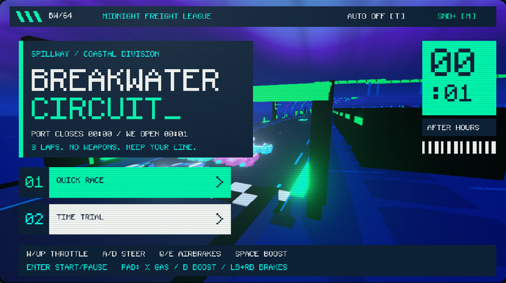
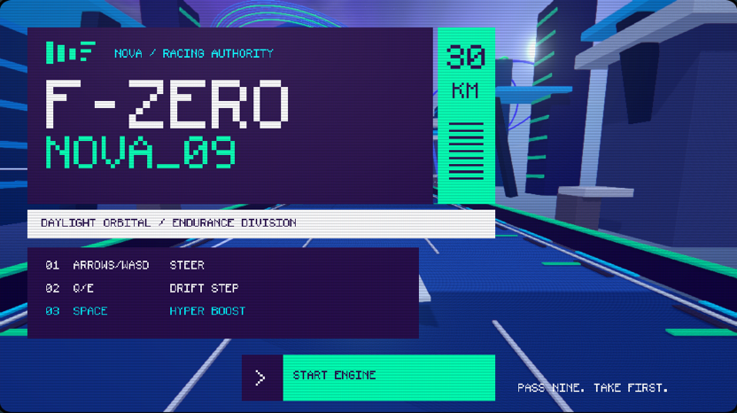
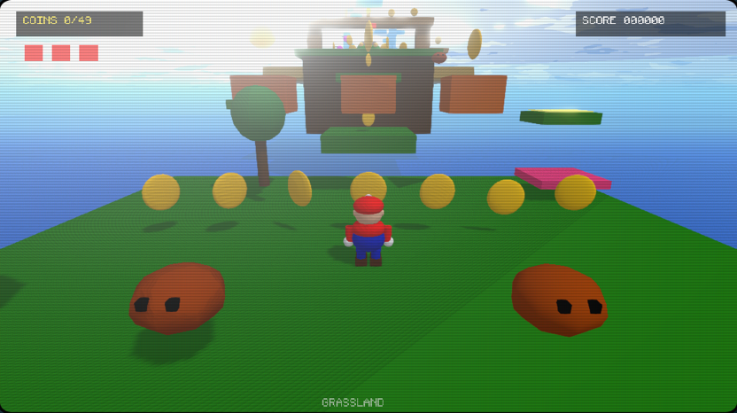
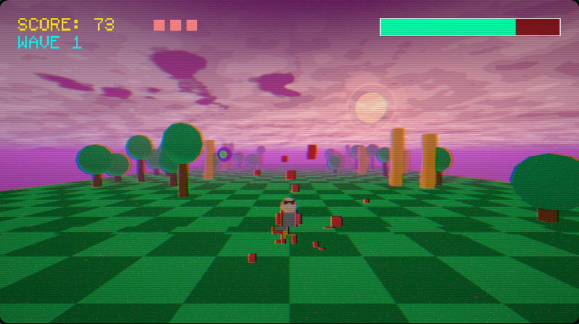
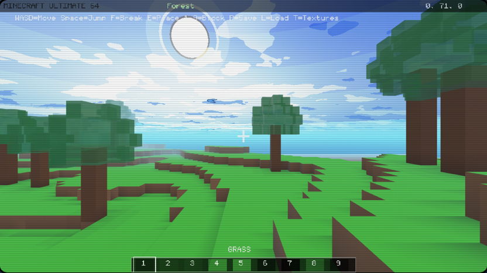
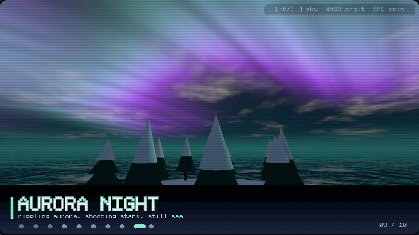

# Nova64 — JavaScript 3D fantasy console

Build small 3D games, explore playable demos, and experiment with neon worlds,
procedural skies and retro graphics. Nova64 combines an N64/PlayStation-inspired
look with modern GPU rendering, a JavaScript cartridge API and a browser-based
console and editor.

[Play on nova64.io](https://nova64.io/) ·
[Get the npm package](https://www.npmjs.com/package/nova64) ·
[Download native cores](https://github.com/seacloud9/nova64/releases) ·
[Documentation](https://nova64.io/docs)

[](https://www.npmjs.com/package/nova64)
[](https://github.com/seacloud9/nova64/actions/workflows/ci.yml)
[](https://github.com/seacloud9/nova64/blob/main/LICENSE)

## Play locally

Use Node.js 22 or newer; Node 24 is used for repository development and releases.
With pnpm installed:

```sh
pnpm dlx nova64@latest --start-demo
```

This downloads the published package, starts its local server and opens the
Nova64 homepage. The Disc Vault launches games; the console lets you choose a
cart and switch between Three.js and Babylon.js.

If port 3000 is occupied:

```sh
pnpm dlx nova64@latest --start-demo --port 4300
```

Open `http://localhost:4300/`. Use `--no-open` to start without opening a browser.
The npm package includes the built console, development runner, templates and
assets; no source checkout or local production build is needed to play.

## Recent additions

- **Authored neon glow:** Three.js honors explicit emission intensity and mesh
  colors, so neon effects render as the cart author intended.
- **A new homepage and Disc Vault:** direct game links, refreshed thumbnails
  and a bundled demo player, also available through the installed CLI.
- **Breakwater Circuit:** an original antigravity racer with three-lap Quick
  Race against five AI rivals, Time Trial, Slip Charge and saved best times.
- **F-Zero Nova:** a vivid orbital speedway with a ringed planet, illuminated
  architecture, violet atmosphere, UnrealBloom and boost distortion.
- **Procedural skies:** reusable presets, animated atmospheres and sky-driven
  reflections, with coordinated fog across multiple games.
- **Babylon improvements:** shared sky shaders, corrected ambient lighting,
  production console support and an engine switch that retains the current cart.
- **Input improvements:** controller face-button presses survive overlapping
  Start/Select mappings; touch controls share the keyboard/gamepad input path.

See the [release notes](https://github.com/seacloud9/nova64/blob/main/docs/releases/v0.5.11.md)
and [changelog](https://github.com/seacloud9/nova64/blob/main/CHANGELOG.md).
The `main` branch can contain changes that are not yet in the npm package;
the changelog distinguishes released and unreleased work.

## What you can build

- **Games:** racers, platformers, space combat, dungeon crawlers and voxel worlds.
- **Visual experiments:** particles, instancing, PBR materials, procedural skies,
  shader showcases and demoscene effects.
- **Interactive carts:** 2D HUDs over 3D scenes, keyboard/controller/touch input,
  sound effects, music, saved progress, tweens and game helpers.
- **Browser experiences:** Game Studio editing and preview, an OS9-style desktop
  shell, and experimental XR, multiplayer and media APIs.

Three.js is the primary browser renderer. Babylon.js is an experimental
alternative; effects and host behavior are not identical across every backend.

## Create a game

Install the CLI, scaffold a project, install its dependencies and start editing:

```sh
pnpm add -g nova64
nova64 init my-game
cd my-game
pnpm install
pnpm dev
```

Edit `code.js` and watch the local preview update. The generated project pins its
Nova64 dependency to the installed CLI version range.

Start from an existing game instead:

```sh
nova64 template star-fox-nova-3d
cd star-fox-nova-3d
pnpm install
pnpm dev
```

Run `nova64 template` for the interactive picker or `nova64 --help` for commands.

## 🎨 **Creating Your First 3D Cart**

Carts have three lifecycle functions: `init()` creates long-lived objects,
`update(dt)` handles simulation and input, and `draw()` renders the HUD. The
runtime renders the 3D scene automatically.

Paste this script into Game Studio:

```javascript
let player, ground;
let score = 0;

function init() {
  // Create ALL 3D objects here — never inside draw()
  ground = nova64.scene.createPlane(50, 50, 0x2a4d3a, [0, 0, 0]);
  nova64.scene.rotateMesh(ground, -Math.PI / 2, 0, 0);
  player = nova64.scene.createCube(1, 0x0088ff, [0, 1, 0], { material: 'metallic' });

  nova64.light.setFog(0x1a1a2e, 10, 30);
  nova64.light.setAmbientLight(0x334466, 1.0);
}

function update(dt) {
  // Handle input and game logic
  if (nova64.input.key('KeyW')) nova64.scene.setPosition(player, 0, 1, -5 * dt);
  if (nova64.input.key('KeyS')) nova64.scene.setPosition(player, 0, 1, 5 * dt);

  nova64.camera.setCameraPosition(0, 5, 10);
  nova64.camera.setCameraTarget(0, 1, 0);
}

function draw() {
  // 2D HUD overlay — 3D renders automatically
  nova64.draw.print(`Score: ${score}`, 10, 10, nova64.draw.rgba8(255, 255, 255, 255));
}
```

For a file-based `code.js` loaded by `nova64 dev`, add:

```javascript
export { init, update, draw };
```

Studio accepts the exported form too, but does not support module imports in
its script payload. Always use the grouped `nova64.*` API. HUD text uses
`nova64.draw.print`; bare `print()` is not the HUD API.

## 📚 **API Reference**

| Namespace                         | Purpose                                          |
| --------------------------------- | ------------------------------------------------ |
| `nova64.scene`                    | Meshes, materials, transforms and instancing     |
| `nova64.camera` / `nova64.light`  | Camera, lighting, fog and skies                  |
| `nova64.fx`                       | Bloom, anti-aliasing, vignette and other effects |
| `nova64.draw` / `nova64.ui`       | 2D overlays, text and interface controls         |
| `nova64.input` / `nova64.audio`   | Controls, sound effects and music                |
| `nova64.data`                     | Saved cart data                                  |
| `nova64.voxel` / `nova64.physics` | Voxel worlds and physics helpers                 |

For example, scene and effect calls remain namespaced:

```javascript
nova64.scene.createCube(2, 0x00aaff, [0, 1, -5]);
nova64.light.setAmbientLight(0xffffff, 1);
nova64.fx.enableBloom(1.2, 0.7, 0.85);
```

Browse the [live documentation on nova64.io](https://nova64.io/docs):

- [API cheatsheet](https://nova64.io/docs/CHEATSHEET)
- [3D graphics API](https://nova64.io/docs/api-3d)
- [Visual effects and bloom](https://nova64.io/docs/api-effects)
- [Skybox API](https://nova64.io/docs/api-skybox)
- [Keyboard, controller and mouse input](https://nova64.io/docs/input)
- [Touch controls](https://nova64.io/docs/TOUCH_CONTROLS)
- [NovaOS shell](https://nova64.io/docs/os)

For implementation details, see the [backend reference in the repository](https://github.com/seacloud9/nova64/blob/main/docs/BACKEND_RUNTIME.md).

## 🎪 Demo gallery

The installed homepage and console include the complete demo selection. These
are a few starting points; links below open their source carts.

| Breakwater Circuit                                                                                                                                                                                           | F-Zero Nova                                                                                                                                                                                   | Super Plumber 64                                                                                                                                                                                       |
| ------------------------------------------------------------------------------------------------------------------------------------------------------------------------------------------------------------ | --------------------------------------------------------------------------------------------------------------------------------------------------------------------------------------------- | ------------------------------------------------------------------------------------------------------------------------------------------------------------------------------------------------------ |
| [](https://github.com/seacloud9/nova64/tree/main/examples/breakwater-circuit) | [](https://github.com/seacloud9/nova64/tree/main/examples/f-zero-nova-3d) | [](https://github.com/seacloud9/nova64/tree/main/examples/super-plumber-64) |

| Space Harrier                                                                                                                                                                                       | Voxel World                                                                                                                                                                                   | Sky Showcase                                                                                                                                                                                     |
| --------------------------------------------------------------------------------------------------------------------------------------------------------------------------------------------------- | --------------------------------------------------------------------------------------------------------------------------------------------------------------------------------------------- | ------------------------------------------------------------------------------------------------------------------------------------------------------------------------------------------------ |
| [](https://github.com/seacloud9/nova64/tree/main/examples/space-harrier-3d) | [](https://github.com/seacloud9/nova64/tree/main/examples/minecraft-demo) | [](https://github.com/seacloud9/nova64/tree/main/examples/skybox-showcase) |

Browse [all example carts](https://github.com/seacloud9/nova64/tree/main/examples),
including the [QWEN Arcade experiments](https://github.com/seacloud9/nova64/tree/main/examples/QWEN).

## Browser, desktop and native hosts

| Host              | Where to start                                                                                                                                                      |
| ----------------- | ------------------------------------------------------------------------------------------------------------------------------------------------------------------- |
| Browser / npm     | `nova64 --start-demo`; Three.js by default, Babylon via the console switch                                                                                          |
| RetroArch         | [Prebuilt core downloads](https://github.com/seacloud9/nova64/releases) and [installation guide](https://github.com/seacloud9/nova64/blob/main/retroarch/README.md) |
| Godot             | [Godot host source and setup](https://github.com/seacloud9/nova64/blob/main/nova64-godot/README.md)                                                                 |
| Electron desktop  | [Source workspace](https://github.com/seacloud9/nova64/blob/main/apps/desktop/README.md)                                                                            |
| VS Code extension | [Source workspace](https://github.com/seacloud9/nova64/blob/main/extensions/vscode/README.md)                                                                       |

Native core releases cover Windows, Linux, macOS, Android, iOS and tvOS, including
ARM Linux targets. Downloads include `SHA256SUMS.txt`. Device installation and
available APIs depend on the host; a browser rendering feature is not a promise
of identical native output.

The Godot host embeds QuickJS through a GDExtension. The desktop app and VS Code
extension share host-neutral packages and are developed from the repository;
they are separate from the root npm package's browser-console distribution.

## Develop from source

Use Node 24 from `.nvmrc` and pnpm. On Windows, use WSL for repository development.

```sh
git clone --recurse-submodules https://github.com/seacloud9/nova64.git
cd nova64
nvm use
pnpm install --frozen-lockfile
pnpm dev --host 127.0.0.1 --port 3199
```

Open `http://127.0.0.1:3199/`. Build and preview production assets with:

```sh
pnpm build
pnpm preview
```

When editing a cart, mirror its `code.js` from `examples/<cart>/` into
`dist/examples/<cart>/`; see [AGENTS.md](https://github.com/seacloud9/nova64/blob/main/AGENTS.md)
for the shared repository workflow. Runtime changes need a build to refresh
generated distribution copies.

Useful checks:

```sh
pnpm test                 # Core runtime, cart, CLI and distribution checks
pnpm test:quick           # Short everyday smoke suite
pnpm test:all             # Extended CLI/API/input/integration suites
pnpm test:playwright      # Browser coverage
pnpm test:babylon         # Focused backend parity coverage
pnpm lint
```

Use `F9` for the debug panel, `?debug=1` to open it on load, and `Shift+X` for the
developer console. Architecture and host-specific workflows live in the
[live documentation](https://nova64.io/docs) and
[source guides](https://github.com/seacloud9/nova64/tree/main/docs);
queued work is tracked in [BACKLOG.md](https://github.com/seacloud9/nova64/blob/main/BACKLOG.md).

## Releases and license

Nova64 is [MIT licensed](https://github.com/seacloud9/nova64/blob/main/LICENSE).
Source is public; prebuilt distribution bundles are available through the
[project site](https://nova64.io/).

Maintainers: `pnpm release` validates, creates a version commit and tags locally.
A pushed version tag builds all platform cores before publishing npm. npm may
validate an accepted upload before it becomes installable; confirm the public
registry version and test a clean install. See the
[release guide](https://github.com/seacloud9/nova64/blob/main/RELEASING.md).

A README change on GitHub appears on npm when it is included in a newly published
package. Historical release details are in the
[changelog](https://github.com/seacloud9/nova64/blob/main/CHANGELOG.md).
